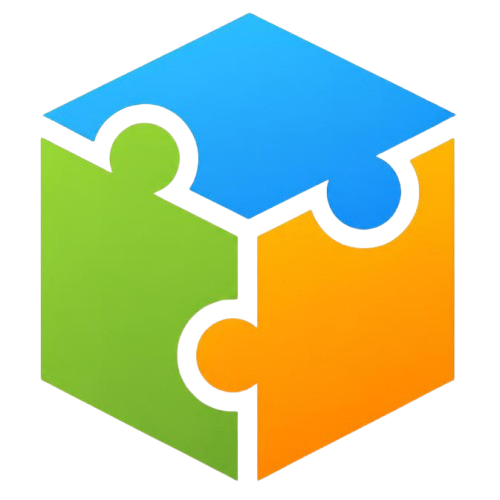

# Jigsaw — Desktop

**A calm, level-based jigsaw puzzle game for Linux, Windows and macOS.**

This repository is the public download home for Jigsaw desktop. It contains
compiled release binaries only — the Flutter/Dart source code is not published
here.

<p align="center">
  
</p>

<p align="center">
  <a href="https://github.com/jinosh05/jigsaw-desktop/releases/latest"></a>
  <a href="https://jinosh05.github.io/jigsaw-desktop/"></a>
</p>

## Download

Get the latest release from the **[download page](https://jinosh05.github.io/jigsaw-desktop/)**
or use the direct links below.

| Platform | Requirements | Download |
|---|---|---|
| **Linux** x64 | GTK 3, libsecret, WebKitGTK 4.1 | [Jigsaw-linux-x64.tar.gz](https://github.com/jinosh05/jigsaw-desktop/releases/latest/download/Jigsaw-linux-x64.tar.gz) |
| **Windows** x64 | Windows 10+, Edge WebView2 | [Jigsaw-windows-x64.zip](https://github.com/jinosh05/jigsaw-desktop/releases/latest/download/Jigsaw-windows-x64.zip) |
| **macOS** Apple Silicon | macOS 12+ | [Jigsaw-macos-arm64.dmg](https://github.com/jinosh05/jigsaw-desktop/releases/latest/download/Jigsaw-macos-arm64.dmg) |
| **macOS** Intel | macOS 12+ | [Jigsaw-macos-x64.dmg](https://github.com/jinosh05/jigsaw-desktop/releases/latest/download/Jigsaw-macos-x64.dmg) |

Checksums: [SHA256SUMS.txt](https://github.com/jinosh05/jigsaw-desktop/releases/latest/download/SHA256SUMS.txt)
· Machine-readable manifest: [latest.json](https://github.com/jinosh05/jigsaw-desktop/releases/latest/download/latest.json)

## Install

### Linux

```bash
tar -xzf Jigsaw-linux-x64.tar.gz
cd Jigsaw
./jigsaw
```

Install the runtime libraries if they are missing:

```bash
# Ubuntu / Debian
sudo apt install libgtk-3-0 libsecret-1-0 libwebkit2gtk-4.1-0

# Fedora
sudo dnf install gtk3 libsecret webkit2gtk4.1

# Arch Linux
sudo pacman -S gtk3 libsecret webkit2gtk-4.1
```

No system-wide installation is required. Keep the extracted folder together.

### Windows

1. Extract `Jigsaw-windows-x64.zip`.
2. Run `jigsaw.exe` from inside the extracted `Jigsaw` folder.

Windows SmartScreen may warn because this build is not backed by a commercial
code-signing certificate. Choose **More info → Run anyway**. Do not run the
game from inside the ZIP preview; extract it first.

### macOS

1. Open `Jigsaw-macos-arm64.dmg` (Apple Silicon) or `Jigsaw-macos-x64.dmg`
   (Intel).
2. Drag **Jigsaw** into **Applications**.
3. On first launch, macOS Gatekeeper may block the unsigned build. Open
   **System Settings → Privacy & Security**, click **Open Anyway**, then
   confirm. On older macOS versions you can also right-click the app and choose
   **Open**.

These builds are not notarized by Apple because that requires a paid Developer
ID. The binaries are ad-hoc signed and run normally after the one-time
confirmation.

## Verify a download

Every release ships with `SHA256SUMS.txt`. Verify the file you downloaded:

```bash
# Linux
sha256sum -c SHA256SUMS.txt

# macOS
shasum -a 256 -c SHA256SUMS.txt

# Windows (PowerShell)
Get-FileHash .\Jigsaw-windows-x64.zip -Algorithm SHA256
```

Compare the printed hash with the matching line in `SHA256SUMS.txt`.

## About the build

- Release builds use Flutter AOT compilation with **Dart identifier
  obfuscation** (`--obfuscate --split-debug-info`).
- Only compiled application bundles are published. Dart source, symbol maps and
  debug databases are not included in any release asset.
- Native runner binaries and plugins are stripped before packaging.
- The Linux build targets x86_64 and the macOS build ships both Apple Silicon
  and Intel variants. Windows targets x86_64.

## Updates and data

There is no background updater yet. When a new version is available, download
the latest package and replace the old application folder (Windows/Linux) or
the app in Applications (macOS). Your account progress is synced with the
Jigsaw backend; local settings remain in the platform's app-data directory.

## Links

- [All releases](https://github.com/jinosh05/jigsaw-desktop/releases)
- [Privacy policy](https://jinosh.site/legal/privacy.html)
- [Terms of use](https://jinosh.site/legal/terms.html)
- [Support](https://jinosh.site/contact)
- [Developer](https://github.com/jinosh05)

## License

The Jigsaw desktop binaries are proprietary software. Copyright © 2026 Jinosh
Nadar. All rights reserved. You may download and use the binaries for personal,
non-commercial play. Redistribution, resale, reverse engineering, or
republishing modified builds is not permitted. The game's source code is not
distributed.
